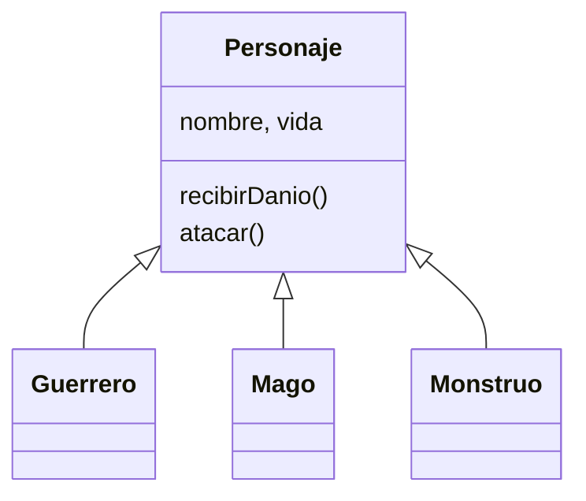

# Aventura: el dragón del castillo 🐉

Elige un guerrero o un mago y ataca al dragón por turnos. Cada vez que pulsas Enter atacas; el dragón responde si sigue vivo. Escribe `salir` para abandonar.

```text
       eliges                     turno
  ┌──────────────┐         ┌─────────────────┐
  │ 1. Guerrero  │ ──────► │ héroe ataca     │
  │ 2. Mago      │         │ dragón responde │
  └──────────────┘         └────────┬────────┘
                              vida llega a 0
                                     ▼
                                fin del juego
```



**Objetos:** el héroe y el dragón tienen nombre y vida propios. `Personaje` reúne los datos y comportamientos compartidos. `Guerrero`, `Mago` y `Monstruo` heredan de él y definen su propio ataque. Al llamar `heroe.atacar()`, Java ejecuta la versión del tipo real del objeto: eso es polimorfismo. La vida es privada y `recibirDanio()` evita que baje de cero.

## Cómo ejecutarlo paso a paso

1. Instala un **JDK** (kit de desarrollo de Java) si todavía no lo tienes. Abre una terminal y comprueba que están disponibles el compilador y Java:

   ```bash
   javac -version
   java -version
   ```

2. Abre la terminal en la carpeta principal de estos proyectos y entra en la carpeta de este ejemplo:

   ```bash
   cd aventura
   ```

   Si ya abriste la terminal dentro de la carpeta `aventura`, omite este paso.

3. Compila el programa:

   ```bash
   javac -encoding UTF-8 Aventura.java
   ```

   Si no aparece ningún error, Java generó los archivos `.class` necesarios.

4. Ejecuta la clase principal desde esa misma carpeta:

   ```bash
   java Aventura
   ```

   Escribe el nombre sin `.java` ni `.class`. Si cambias el código fuente, vuelve a compilar antes de ejecutarlo otra vez.

5. **Usa el programa:** Escribe `1` para elegir al guerrero o `2` para elegir al mago y pulsa Enter. En cada turno pulsa Enter para atacar. También puedes escribir `salir` y pulsar Enter para terminar.

Si `javac` no se reconoce, revisa que el JDK esté instalado y disponible en el `PATH`. Si aparece «archivo no encontrado», comprueba que la terminal esté en la carpeta `aventura`.


**Ejemplo:** el guerrero causa 8 puntos y tiene 30 de vida; el dragón comienza con 25 y causa 6. El guerrero gana tras cuatro ataques si no sales antes.

**Retos:** crea un `Arquero` que cause 7 puntos; agrega una opción al menú. Después, añade una poción que recupere vida con un método de `Personaje`.

## Los principios de POO en este proyecto

### 1. Encapsulación: proteger la vida

`Personaje` guarda `nombre` y `vida` como datos `private`. El resto del programa consulta la vida con `getVida()` y aplica daño con `recibirDanio()`:

```java
private int vida;

void recibirDanio(int danio) {
    vida = Math.max(0, vida - danio);
}
```

Así la regla de no bajar de cero vive en un solo lugar. En este ejemplo los ataques devuelven daño positivo; el método no valida valores negativos, por lo que podría reforzarse si se permitieran otros tipos de ataque.

### 2. Abstracción: ¿qué hace un personaje?

La clase abstracta `Personaje` describe lo que comparten los participantes: tienen nombre y vida, pueden recibir daño y deben poder atacar. Declara `abstract int atacar();` sin decidir cómo ataca cada uno. No creamos un `Personaje` directamente, sino un `Guerrero`, `Mago` o `Monstruo`.

### 3. Herencia: aprovechar lo común

`class Guerrero extends Personaje` indica que un guerrero es un personaje. Por eso puede usar `getNombre()`, `getVida()` y `recibirDanio()` sin volver a definirlos. Su constructor llama a `super(nombre, 30)` para iniciar los datos de la clase padre.

### 4. Polimorfismo: el mismo mensaje, ataques diferentes

```java
Personaje heroe = new Guerrero("Alex");
heroe.atacar(); // Ejecuta el ataque de Guerrero.
```

Aunque la variable es de tipo `Personaje`, el objeto es un `Guerrero`: Java ejecuta su versión de `atacar()`. Si el usuario elige un `Mago`, la misma llamada ejecuta el hechizo. La elección ocurre durante la ejecución.
