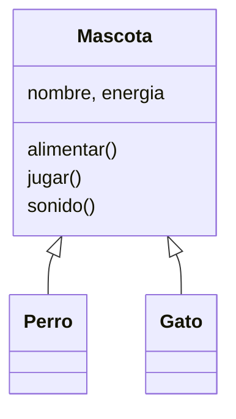

# Mascota virtual 🐾

Elige un perro o un gato, dale un nombre y cuídalo. Alimentar suma 2 puntos de energía hasta un máximo de 10; jugar consume 2. Si tiene menos de 2, necesita comer antes de jugar.

```text
  ┌─────────┐   alimentar (+2)    ┌──────────────┐
  │ Mascota │ ◄───────────────── │ Tú decides   │
  │ energía │ ◄───────────────── │ 1, 2 o 3    │
  └─────────┘     jugar (-2)      └──────────────┘
```



**Objetos:** una mascota conserva su nombre y energía entre acciones. `Mascota` comparte el cuidado; `Perro` y `Gato` heredan ese comportamiento. Cuando `jugar()` llama a `sonido()`, se escucha el sonido definido por la clase concreta. La energía es privada y se modifica con métodos que aplican las reglas.

## Cómo ejecutarlo paso a paso

1. Instala un **JDK** (kit de desarrollo de Java) si todavía no lo tienes. Abre una terminal y comprueba que están disponibles el compilador y Java:

   ```bash
   javac -version
   java -version
   ```

2. Abre la terminal en la carpeta principal de estos proyectos y entra en la carpeta de este ejemplo:

   ```bash
   cd mascotas
   ```

   Si ya abriste la terminal dentro de la carpeta `mascotas`, omite este paso.

3. Compila el programa:

   ```bash
   javac -encoding UTF-8 Mascotas.java
   ```

   Si no aparece ningún error, Java generó los archivos `.class` necesarios.

4. Ejecuta la clase principal desde esa misma carpeta:

   ```bash
   java Mascotas
   ```

   Escribe el nombre sin `.java` ni `.class`. Si cambias el código fuente, vuelve a compilar antes de ejecutarlo otra vez.

5. **Usa el programa:** Escribe `1` para perro o `2` para gato y pulsa Enter. Escribe un nombre y pulsa Enter. En el menú, escribe `1` para alimentar, `2` para jugar o `3` para salir; pulsa Enter después de cada opción.

Si `javac` no se reconoce, revisa que el JDK esté instalado y disponible en el `PATH`. Si aparece «archivo no encontrado», comprueba que la terminal esté en la carpeta `mascotas`.


**Ejemplo:** elige `1`, escribe `Luna` y después `2`: Luna juega, dice «¡Guau!» y pasa de 5 a 3 puntos. Elige `1` para recuperar 2 puntos y `3` para salir.

**Retos:** agrega un `Pajaro` con su propio sonido; después, crea una acción para dormir que recupere energía.

## Los principios de POO en este proyecto

### 1. Encapsulación: controlar la energía

`Mascota` mantiene `nombre` y `energia` como `private`. El programa consulta la energía con `getEnergia()` y la cambia mediante `alimentar()` o `jugar()`. Esos métodos concentran las reglas: la energía no supera 10 y jugar requiere al menos 2 puntos.

```java
void alimentar() {
    energia = Math.min(10, energia + 2);
    System.out.println(nombre + " comió.");
}
```

### 2. Abstracción: una idea común de mascota

`Mascota` es abstracta: representa lo que necesitan todas las mascotas del programa, sin exigir que todas hagan el mismo sonido. Define la operación `sonido()`, pero cada tipo concreto decide qué devuelve. No se crea un objeto `new Mascota(...)`.

### 3. Herencia: compartir el cuidado

`Perro extends Mascota` y `Gato extends Mascota`: ambos heredan las acciones `alimentar()` y `jugar()`. Sus constructores llaman a `super(nombre)` para inicializar el nombre común. Cada clase hija solo necesita añadir su versión de `sonido()`.

### 4. Polimorfismo: cada mascota responde a su manera

```java
Mascota mascota = new Gato("Michi");
mascota.jugar(); // Al jugar se llama a sonido(): ¡Miau!
```

La variable tiene tipo `Mascota`, pero el objeto es un `Gato`. Dentro de `jugar()`, la llamada a `sonido()` ejecuta la versión de `Gato`; si el objeto fuera un `Perro`, ejecutaría la del perro. El mismo comportamiento compartido se adapta al objeto concreto.
