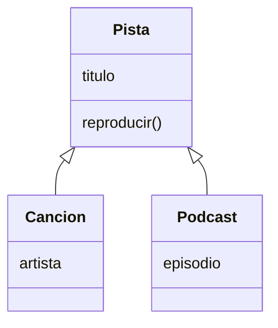

# Mini reproductor 🎵

Una lista mezcla canciones y podcasts. Al pulsar Enter, el programa muestra cómo se reproduciría cada elemento. Es una **simulación de texto**, sin sonido ni archivos multimedia.

```text
 ┌─────────────────────┐
 │ 1. Canción          │ ──► ♪ título y artista
 │ 2. Podcast          │ ──► 🎙 título y episodio
 │ 3. Canción          │ ──► ♪ título y artista
 └─────────────────────┘
          lista
```



**Objetos:** cada pista tiene título; una canción también tiene artista y un podcast tiene número de episodio. Ambos heredan de `Pista`. La lista tiene tipo `Pista[]`, pero guarda objetos de las dos clases hijas. El mismo mensaje `reproducir()` produce una salida distinta para cada objeto.

## Cómo ejecutarlo paso a paso

1. Instala un **JDK** (kit de desarrollo de Java) si todavía no lo tienes. Abre una terminal y comprueba que están disponibles el compilador y Java:

   ```bash
   javac -version
   java -version
   ```

2. Abre la terminal en la carpeta principal de estos proyectos y entra en la carpeta de este ejemplo:

   ```bash
   cd musica
   ```

   Si ya abriste la terminal dentro de la carpeta `musica`, omite este paso.

3. Compila el programa:

   ```bash
   javac -encoding UTF-8 Musica.java
   ```

   Si no aparece ningún error, Java generó los archivos `.class` necesarios.

4. Ejecuta la clase principal desde esa misma carpeta:

   ```bash
   java Musica
   ```

   Escribe el nombre sin `.java` ni `.class`. Si cambias el código fuente, vuelve a compilar antes de ejecutarlo otra vez.

5. **Usa el programa:** El programa muestra las pistas disponibles. Pulsa Enter para recorrer la lista y ver la simulación de reproducción. Al terminar la lista, el programa finaliza.

Si `javac` no se reconoce, revisa que el JDK esté instalado y disponible en el `PATH`. Si aparece «archivo no encontrado», comprueba que la terminal esté en la carpeta `musica`.


**Ejemplo:** al pulsar Enter se muestran, en orden, «Viaje espacial», el episodio 3 de «Ideas curiosas» y «Amanecer».

**Retos:** añade una clase `Audiolibro` con autor y agrégala a la lista. Luego cambia el orden de las pistas y observa la salida.

## Los principios de POO en este proyecto

### 1. Encapsulación: datos propios de cada pista

`Pista` guarda su `titulo` como `private final` y ofrece `getTitulo()` para consultarlo. `Cancion` guarda de forma privada su `artista`, mientras que `Podcast` guarda su número de `episodio`. Cada objeto conserva sus propios datos y los usa al mostrar su información.

### 2. Abstracción: pensar en una pista reproducible

La clase abstracta `Pista` define una idea común: cualquier elemento de la lista tiene un título y sabe responder a `reproducir()`. No especifica el formato de salida: eso depende del tipo concreto. Aquí «reproducir» significa imprimir texto; no se procesa audio.

### 3. Herencia: reutilizar el título

`Cancion extends Pista` y `Podcast extends Pista`. Sus constructores llaman a `super(titulo)` para inicializar el título compartido. Cada clase hija añade sus propios datos y redefine `reproducir()`.

### 4. Polimorfismo: recorrer una lista variada

```java
for (Pista pista : lista) {
    pista.reproducir();
}
```

La variable `pista` puede referirse a una canción o a un podcast. En cada vuelta, Java ejecuta la versión de `reproducir()` del objeto concreto: una muestra artista y la otra muestra episodio. El ciclo no necesita preguntar qué tipo de pista recibió.
