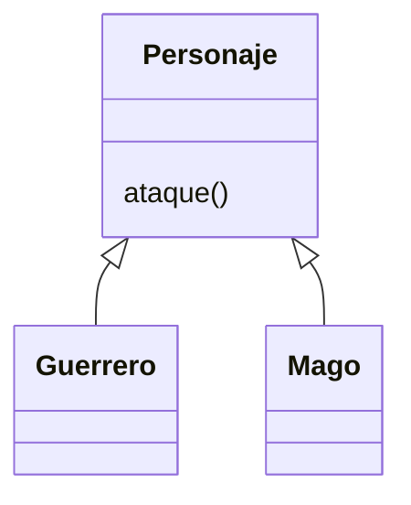

# Aventura contra el dragón

Con un JDK instalado, abre una terminal en la carpeta principal de los proyectos desde tu escritorio.

```bash
cd swing/aventura
javac -encoding UTF-8 AventuraVisual.java
java AventuraVisual
```

Elige Guerrero o Mago, pulsa **Nueva partida** y luego **Atacar**. Con el mago ganas en tres turnos.



**POO.** La clase abstracta define una operación común. Las clases hijas heredan ese contrato y el polimorfismo permite ejecutar la implementación del objeto concreto. Personaje protege la vida y comparte la operación de recibir daño. Cada tipo de combatiente calcula un ataque distinto.

**Interfaz.** Un evento de Swing llama al código que aplica la acción. La ventana muestra su resultado.
