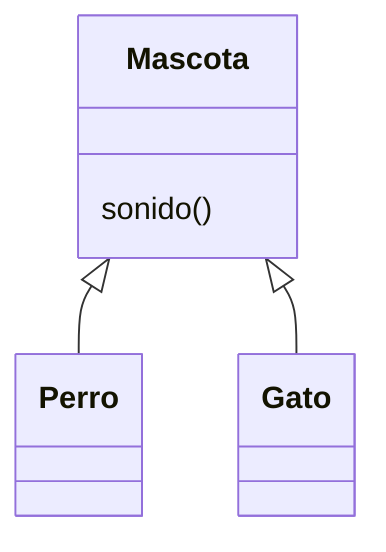

# Mascota virtual

Con un JDK instalado, abre una terminal en la carpeta principal de los proyectos desde tu escritorio.

```bash
cd swing/mascotas
javac -encoding UTF-8 MascotasVisual.java
java MascotasVisual
```

Elige una especie, escribe un nombre y pulsa **Adoptar**. Usa **Alimentar** y **Jugar** para cambiar la energía.



**POO.** La clase abstracta define una operación común. Las clases hijas heredan ese contrato y el polimorfismo permite ejecutar la implementación del objeto concreto. Mascota protege la energía y comparte las reglas de cuidado. Al jugar, el sonido depende de la especie.

**Interfaz.** Un evento de Swing llama al código que aplica la acción. La ventana muestra su resultado.
