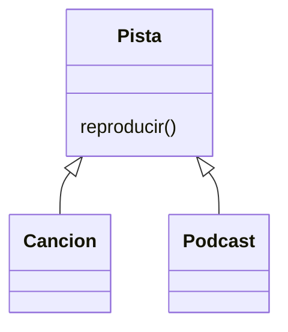

# Mini reproductor

Con un JDK instalado, abre una terminal en la carpeta principal de los proyectos desde tu escritorio.

```bash
cd swing/musica
javac -encoding UTF-8 MusicaVisual.java
java MusicaVisual
```

Selecciona una pista y pulsa **Reproducir**. Pulsa **Siguiente** para cambiar de pista. La reproducción se simula con texto.



**POO.** La clase abstracta define una operación común. Las clases hijas heredan ese contrato y el polimorfismo permite ejecutar la implementación del objeto concreto. Pista protege el título. La canción añade el artista y el podcast añade el episodio. La misma acción muestra datos distintos.

**Interfaz.** Un evento de Swing llama al código que aplica la acción. La ventana muestra su resultado.
