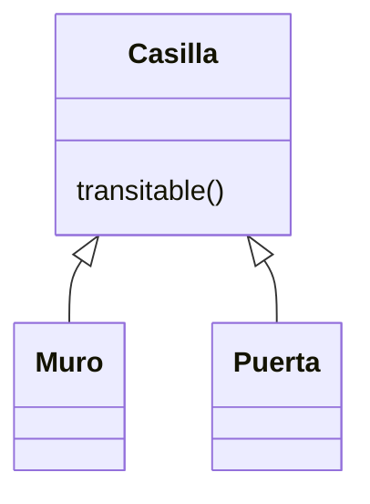

# Laboratorio Robot

Con un JDK instalado, abre una terminal en la carpeta principal de los proyectos desde tu escritorio.

```bash
cd swing/robot
javac -encoding UTF-8 *.java
java LaboratorioRobot
```

Usa las flechas del teclado o los botones. Empuja la caja sobre la placa, cruza la puerta y llega a la salida. Pulsa **Reiniciar** para empezar de nuevo.



**POO.** La clase abstracta define una operación común. Las clases hijas heredan ese contrato y el polimorfismo permite ejecutar la implementación del objeto concreto. Partida protege posiciones y pasos. Suelo, Muro y Puerta heredan el contrato de Casilla. El suelo permite pasar, el muro bloquea y la puerta depende de la placa.

**Interfaz.** Un evento de Swing llama al código que aplica la acción. La ventana muestra su resultado.

## Plan del proyecto final

El reto tiene un solo nivel. La caja abre la puerta mientras ocupa la placa. Para ganar, el jugador tiene que acercarse a la caja desde el lado adecuado, empujarla hasta la placa y rodearla para cruzar la puerta.

```text
# # # # # # # #
# R · · · · # #
# · C · P G S #
# · · # · · # #
# # # # # # # #

R Robot    C Caja    P Placa    G Puerta    S Salida
# Muro     · Suelo
```

1. Modelar el mapa y comprobar qué casillas permiten el paso.
2. Incorporar el empuje y contar solo movimientos válidos.
3. Hacer que la puerta responda a la posición de la caja.
4. Conectar teclado y botones con el mismo método de movimiento.
5. Comprobar la victoria y el reinicio.

`Partida.java` aplica las reglas sin depender de Swing. `LaboratorioRobot.java` muestra el estado del modelo. Para ampliar el ejercicio, modifica el mapa y busca una solución sin cambiar las reglas.

**Solución para el docente.** Abajo, derecha, derecha, arriba, derecha, derecha, abajo, derecha.
