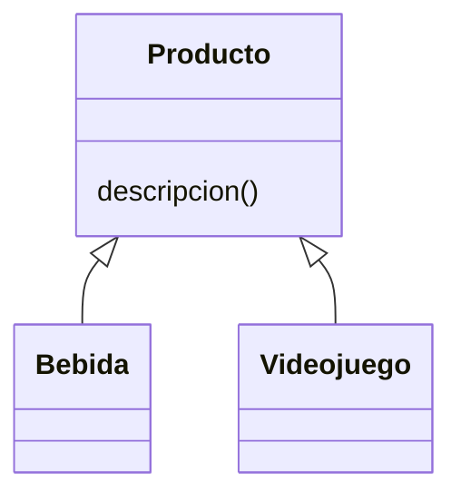

# Tienda y carrito

Con un JDK instalado, abre una terminal en la carpeta principal de los proyectos desde tu escritorio.

```bash
cd swing/tienda
javac -encoding UTF-8 TiendaVisual.java
java TiendaVisual
```

Añade una limonada y un videojuego. Pulsa **Pagar** para ver el ticket de $145. Cierra el ticket para iniciar una nueva compra.



**POO.** La clase abstracta define una operación común. Las clases hijas heredan ese contrato y el polimorfismo permite ejecutar la implementación del objeto concreto. Producto protege nombre y precio. Cada tipo hereda las consultas comunes y aporta su descripción al carrito.

**Interfaz.** Un evento de Swing llama al código que aplica la acción. La ventana muestra su resultado.
