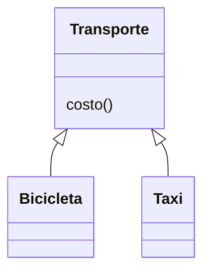

# Comparador de transporte

Con un JDK instalado, abre una terminal en la carpeta principal de los proyectos desde tu escritorio.

```bash
cd swing/transporte
javac -encoding UTF-8 TransporteVisual.java
java TransporteVisual
```

Escribe una distancia entera de 1 a 1000 y pulsa **Comparar**. Con 5 km el autobús es el más barato.



**POO.** La clase abstracta define una operación común. Las clases hijas heredan ese contrato y el polimorfismo permite ejecutar la implementación del objeto concreto. Transporte protege el nombre y define el cálculo común. Cada tipo usa su fórmula. Autobus también hereda de Transporte.

**Interfaz.** Un evento de Swing llama al código que aplica la acción. La ventana muestra su resultado.
