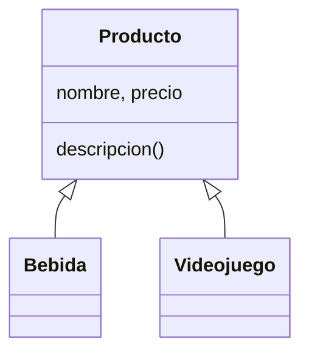

# Tienda y carrito 🛒

Agrega limonadas y videojuegos a un carrito. Al elegir `0`, se muestra un ticket con cada artículo y el total en pesos enteros.

```text
 ┌────────────┐      agregar       ┌────────────┐
 │  Catálogo  │ ─────────────────► │  Carrito   │
 └────────────┘                    └─────┬──────┘
                                         ▼
                                 artículos + total
```



**Objetos:** cada producto tiene nombre y precio. `Bebida` y `Videojuego` heredan de `Producto` y ofrecen distintas descripciones. El catálogo y el carrito guardan referencias de tipo `Producto`; al llamar `descripcion()`, se ejecuta la versión correspondiente. `ArrayList` es una lista de la biblioteca estándar que puede crecer al agregar artículos.

## Cómo ejecutarlo paso a paso

1. Instala un **JDK** (kit de desarrollo de Java) si todavía no lo tienes. Abre una terminal y comprueba que están disponibles el compilador y Java:

   ```bash
   javac -version
   java -version
   ```

2. Abre la terminal en la carpeta principal de estos proyectos y entra en la carpeta de este ejemplo:

   ```bash
   cd tienda
   ```

   Si ya abriste la terminal dentro de la carpeta `tienda`, omite este paso.

3. Compila el programa:

   ```bash
   javac -encoding UTF-8 Tienda.java
   ```

   Si no aparece ningún error, Java generó los archivos `.class` necesarios.

4. Ejecuta la clase principal desde esa misma carpeta:

   ```bash
   java Tienda
   ```

   Escribe el nombre sin `.java` ni `.class`. Si cambias el código fuente, vuelve a compilar antes de ejecutarlo otra vez.

5. **Usa el programa:** Escribe `1` para agregar una limonada o `2` para agregar un videojuego y pulsa Enter. Puedes repetir las opciones para agregar varios artículos. Escribe `0` y pulsa Enter para ver el ticket y terminar.

Si `javac` no se reconoce, revisa que el JDK esté instalado y disponible en el `PATH`. Si aparece «archivo no encontrado», comprueba que la terminal esté en la carpeta `tienda`.


**Ejemplo:** escribe `1`, `2` y `0`: se agregan una limonada de $25 y un videojuego de $120; el total es $145. Si eliges `0` inmediatamente, el total es $0.

**Retos:** crea una clase `Libro` y agrégala al catálogo y al menú. Después, muestra el número de artículos usando `carrito.size()`.

## Los principios de POO en este proyecto

### 1. Encapsulación: guardar los datos del producto

`Producto` declara `nombre` y `precio` como `private final`: cada objeto recibe esos datos al crearse y no se modifican después. Los demás métodos los consultan mediante `getNombre()` y `getPrecio()`. Así el ticket no necesita acceder directamente a los campos.

### 2. Abstracción: definir qué es un producto

La clase abstracta `Producto` reúne lo necesario para vender un artículo en este programa: nombre, precio y una descripción. Declara `abstract String descripcion();`, pero deja a cada tipo concreto decidir el texto. El programa trabaja con esa idea general sin necesitar los detalles de cada artículo para sumar su precio.

### 3. Herencia: crear tipos de producto

`Bebida` y `Videojuego` usan `extends Producto`. Ambos reciben los datos comunes mediante `super(nombre, precio)` y heredan los métodos de consulta. Cada clase añade su propia implementación de `descripcion()`.

### 4. Polimorfismo: un catálogo con distintos objetos

```java
Producto[] catalogo = {
    new Bebida("Limonada", 25),
    new Videojuego("Aventura espacial", 120)
};
```

Aunque el arreglo es de tipo `Producto[]`, guarda objetos de ambas clases hijas. Al recorrerlo, `p.descripcion()` muestra «Bebida fría» para la bebida y «Juego digital» para el videojuego. El carrito también acepta ambos como `Producto` y suma sus precios de la misma manera.
