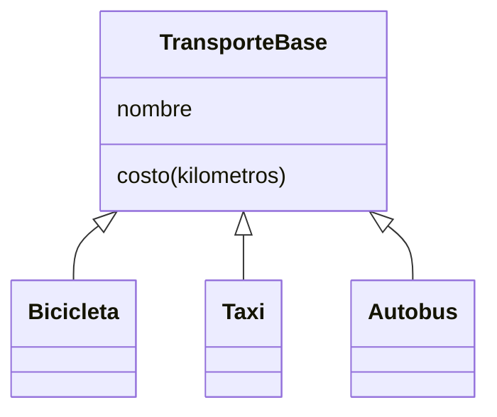

# Comparador de transporte 🚲

Introduce una distancia entera entre 1 y 1000 km. El programa calcula precios imaginarios en pesos y muestra una de las opciones más económicas; si hay empate conserva la primera que aparece.

```text
             distancia: 5 km
                    │
        ┌───────────┼───────────┐
        ▼           ▼           ▼
    bicicleta      taxi      autobús
     $5 + 2/km   $20 + 8/km     $12
        │           │           │
       $15         $60         $12  ◄── menor
```



**Objetos:** cada medio tiene un nombre y calcula su costo. Las tres clases heredan de `TransporteBase` e implementan `costo()` con una regla distinta. El programa recorre un arreglo de tipo `TransporteBase[]` y llama al mismo método para cada objeto: Java usa el cálculo de la clase concreta.

## Cómo ejecutarlo paso a paso

1. Instala un **JDK** (kit de desarrollo de Java) si todavía no lo tienes. Abre una terminal y comprueba que están disponibles el compilador y Java:

   ```bash
   javac -version
   java -version
   ```

2. Abre la terminal en la carpeta principal de estos proyectos y entra en la carpeta de este ejemplo:

   ```bash
   cd transporte
   ```

   Si ya abriste la terminal dentro de la carpeta `transporte`, omite este paso.

3. Compila el programa:

   ```bash
   javac -encoding UTF-8 Transporte.java
   ```

   Si no aparece ningún error, Java generó los archivos `.class` necesarios.

4. Ejecuta la clase principal desde esa misma carpeta:

   ```bash
   java Transporte
   ```

   Escribe el nombre sin `.java` ni `.class`. Si cambias el código fuente, vuelve a compilar antes de ejecutarlo otra vez.

5. **Usa el programa:** Escribe una distancia entera entre `1` y `1000` y pulsa Enter. El programa mostrará el precio de cada opción y una de las más económicas; después terminará.

Si `javac` no se reconoce, revisa que el JDK esté instalado y disponible en el `PATH`. Si aparece «archivo no encontrado», comprueba que la terminal esté en la carpeta `transporte`.


**Ejemplo:** para 5 km, bicicleta cuesta $15, taxi $60 y autobús $12; el autobús es la opción más económica.

**Retos:** agrega una clase `Patineta` con su propia fórmula e inclúyela en el arreglo. Después, cambia la distancia y predice cuál será la opción más barata.

## Los principios de POO en este proyecto

### 1. Encapsulación: cada transporte conserva su nombre

`TransporteBase` guarda el nombre en un campo `private final` y permite consultarlo con `getNombre()`. El programa muestra el nombre sin acceder directamente al campo. Las reglas de precio también están dentro del método `costo()` de cada clase concreta.

### 2. Abstracción: comparar sin conocer todas las fórmulas

`TransporteBase` es una clase abstracta que expresa lo que el comparador necesita: un nombre y una operación `costo(kilometros)`. La clase padre no decide el precio; establece que cada medio debe calcularlo. El comparador puede usar esta operación común para todas las opciones.

### 3. Herencia: crear distintos medios

`Bicicleta`, `Taxi` y `Autobus` heredan de `TransporteBase`. Cada constructor llama a `super(...)` para establecer su nombre y cada clase hija implementa su propia fórmula de costo.

### 4. Polimorfismo: una llamada, varias fórmulas

```java
for (TransporteBase opcion : opciones) {
    int precio = opcion.costo(kilometros);
    System.out.println(opcion.getNombre() + ": $" + precio);
}
```

`opcion` tiene tipo `TransporteBase`, pero en cada vuelta puede contener un objeto distinto. La misma llamada a `costo(kilometros)` usa la fórmula de bicicleta, taxi o autobús según el objeto. Así es posible agregar otro transporte al arreglo sin cambiar el ciclo de comparación.
